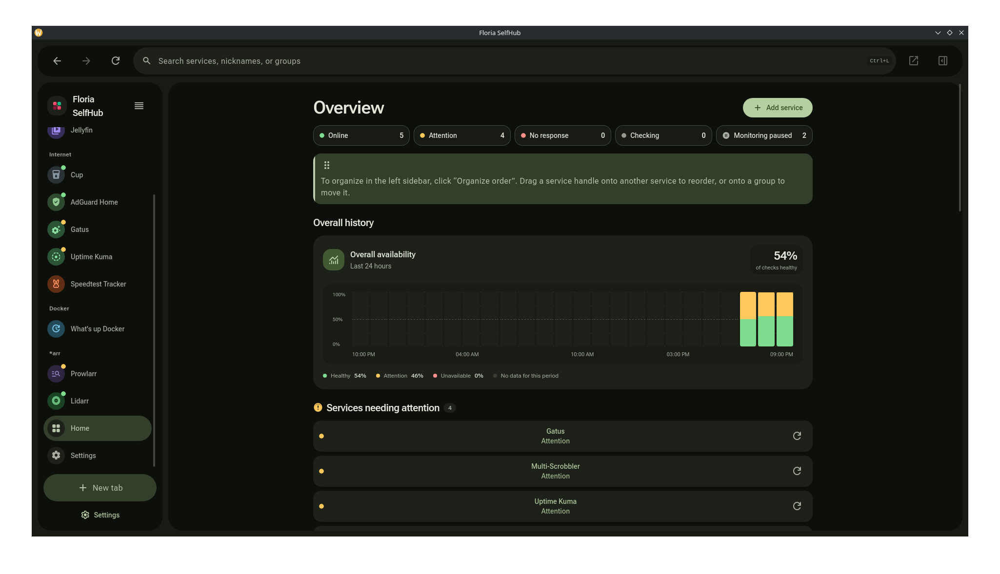
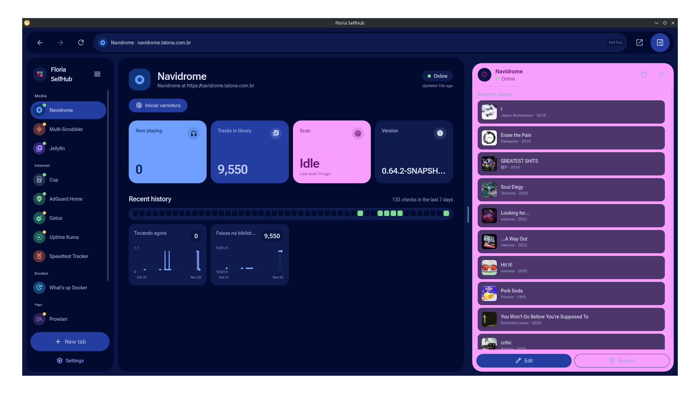
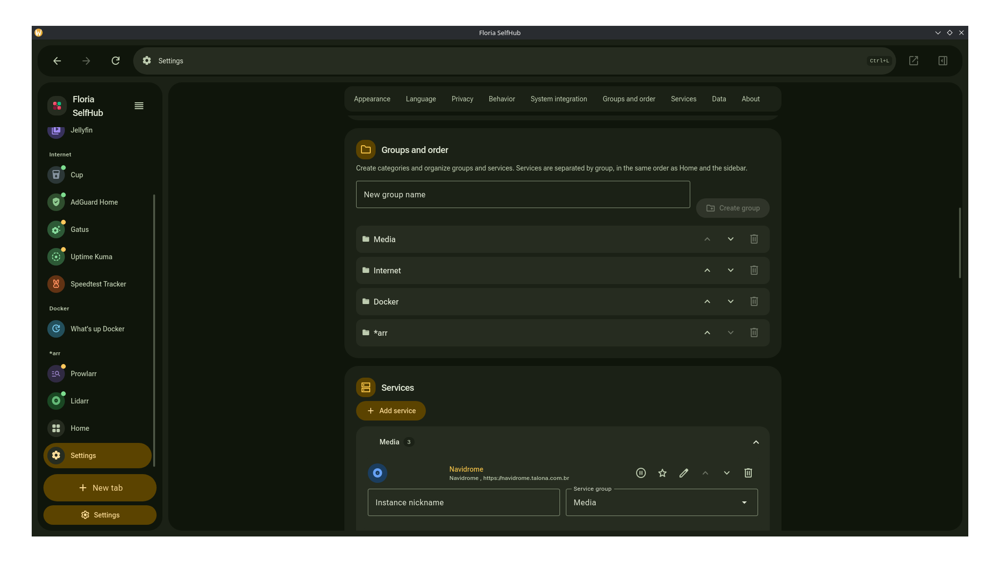
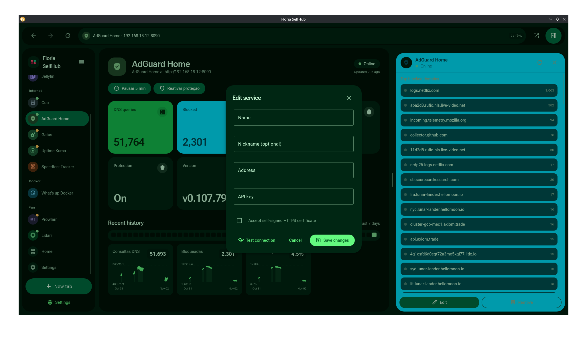
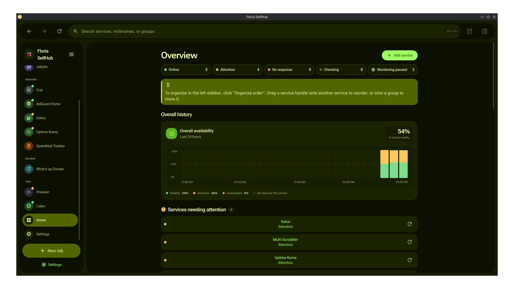
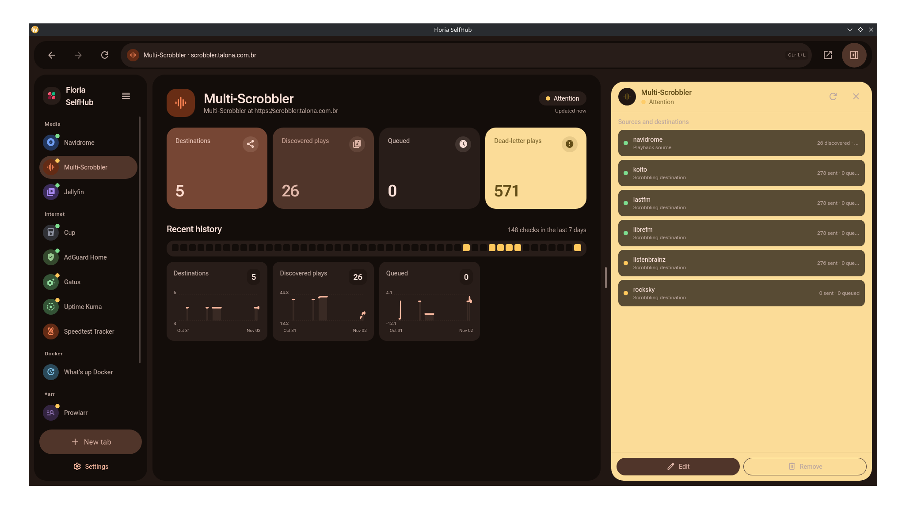

# Floria SelfHub

<p align="center">
  
</p>

<p align="center">
  <strong>Your services. One place.</strong><br>
  A fast desktop dashboard for self-hosted services.
</p>

<p align="center">
  <a href="https://github.com/Floria-Apps/Floria-selfhub/releases/latest">
    
  </a>
  <a href="https://github.com/Floria-Apps/Floria-selfhub/actions/workflows/ci.yml">
    
  </a>
  <a href="https://github.com/Floria-Apps/Floria-selfhub/blob/main/LICENSE.md">
    
  </a>
  <a href="https://github.com/Floria-Apps/Floria-selfhub">
    
  </a>
</p>

Floria SelfHub brings the services in your homelab or self-hosted environment together in one focused application. Keep your Jellyfin, Navidrome, Docker, DNS, monitoring and other dashboards organized without maintaining dozens of browser tabs.

## Highlights

- **Unified dashboard** for self-hosted services.
- **Tabbed workspace** with one view for each service.
- **Service groups and ordering** shared across the dashboard, sidebar and settings.
- **Health and availability history** to identify services that need attention.
- **Service-specific integrations** for sessions, libraries, monitors, DNS, containers and more.
- **System tray support** to keep the application running in the background.
- **Start on login** option for desktop environments that support autostart.
- **Dark and light themes** with localized interface text.
- **Local-first storage** for services, preferences and configuration data.

## Supported services

| Service | Integration | API / protocol |
| --- | --- | --- |
| [ Jellyfin](https://jellyfin.org/) | Sessions and library information | REST (no explicit version) |
| [ Navidrome](https://www.navidrome.org/) | Now playing and library information | Subsonic API 1.16.1 |
| [ Uptime Kuma](https://github.com/louislam/uptime-kuma) | Monitor status | Status page API (no explicit version) |
| [ Gatus](https://github.com/TwiN/gatus) | Endpoint health | API v1 (with legacy-route fallback) |
| [ Speedtest Tracker](https://github.com/alexjustesen/speedtest-tracker) | Internet speed history | API v1 |
| [📦 Cup](https://github.com/sergi0g/cup) | Container image updates | API v3 |
| [🐳 What's Up Docker](https://getwud.github.io/wud/) | Container updates | REST (no explicit version) |
| [ AdGuard Home](https://adguard.com/adguard-home/overview.html) | DNS and blocking information | Control API (no explicit version) |
| [ qBittorrent](https://www.qbittorrent.org/) | Download information | Web API v2 |
| [ Jellyseerr](https://github.com/Fallenbagel/jellyseerr) | Media requests | API v1 |
| [ Radarr](https://radarr.video/) | Arr ecosystem information | API v3 |
| [ Sonarr](https://sonarr.tv/) | Arr ecosystem information | API v3 |
| [ Lidarr](https://lidarr.audio/) | Arr ecosystem information | API v1 |
| [ Readarr](https://github.com/Readarr/Readarr) | Arr ecosystem information | API v1 |
| [ Prowlarr](https://prowlarr.com/) | Arr ecosystem information | API v1 |
| [🎬 Bazarr](https://www.bazarr.media/) | Arr ecosystem information | REST (no explicit version) |
| [ Immich](https://immich.app/) | Photo service information | REST (no explicit version) |
| [📊 Multi-scrobbler](https://github.com/muety/multi-scrobbler) | Media scrobbling information | Prometheus metrics endpoint (no explicit version) |

> More integrations are planned. Service availability may depend on the API version and permissions configured on your instance.

## Screenshots

### Overview

<p align="center">
  
</p>

### Service integrations

<p align="center">
  
  
</p>

<p align="center">
  
  
</p>

### Settings

<p align="center">
  
</p>

## Installation

Download the latest release from the [GitHub Releases page](https://github.com/Floria-Apps/Floria-selfhub/releases).

### Linux

Available packages include:

- **Debian/Ubuntu:** `.deb`
- **Fedora/openSUSE:** `.rpm`
- **Portable Linux:** `.AppImage`
- **Arch Linux:** build with the included `PKGBUILD`

For Debian-based distributions:

```bash
sudo dpkg -i SelfHub_<version>_amd64.deb
```

For Arch Linux, build the package from the repository root:

```bash
makepkg -si
```

### Windows

Download and run the `.exe` NSIS installer from the release assets.

### macOS

Download the `.dmg`, open it, and drag **Floria SelfHub** to the Applications folder. Builds are produced for the macOS runner architecture configured in the release workflow.

## Development

### Requirements

- Node.js 26 or newer
- pnpm 12 or newer
- Rust stable toolchain
- Tauri v2 system dependencies

Install the JavaScript dependencies:

```bash
pnpm install
```

Start the frontend development server:

```bash
pnpm dev
```

Start the Tauri desktop application in development mode:

```bash
pnpm tauri dev
```

### Useful commands

| Command | Description |
| --- | --- |
| `pnpm dev` | Start the Vite development server |
| `pnpm tauri dev` | Run the desktop application in development |
| `pnpm build` | Type-check and build the frontend |
| `pnpm test` | Run the Vitest test suite |
| `pnpm tauri build` | Build the desktop application and bundles |
| `cargo check --locked` | Check the Rust backend |
| `cargo test --locked` | Run Rust tests |
| `cargo fmt --all -- --check` | Validate Rust formatting |
| `cargo clippy --all-targets --all-features` | Run Rust lint checks |

## Project structure

```text
.
├── src/                       # Vue frontend
├── public/                    # Frontend static assets
├── src-tauri/
│   ├── src/                   # Rust/Tauri backend
│   ├── icons/floria-selfhub/  # Application logos and platform icons
│   ├── Cargo.toml             # Rust package and dependencies
│   └── tauri.conf.json        # Tauri application and bundle settings
├── .github/workflows/         # CI and release workflows
├── PKGBUILD                   # Arch Linux package recipe
└── package.json               # Frontend scripts and dependencies
```

## Data and privacy

Service configuration, preferences and local application data are stored on the device. Floria SelfHub does not provide a hosted service and does not require an account. Network requests are made to the service endpoints configured by the user; opening Settings also checks GitHub's public API for updates.

In desktop and iOS builds, API tokens, usernames and passwords are stored in the operating system's credential store (Secret Service on Linux, Keychain on macOS/iOS and Credential Manager on Windows). Credentials saved by older versions are migrated to the system store on first launch. Android and browser builds keep credentials in local storage without app-level encryption.

Exported configuration files omit the dedicated token, username and password fields. Treat service addresses and exported configuration files as sensitive, and do not commit them.

## Releases

Releases are created from version tags such as `v1.4.1`. GitHub Actions builds the release assets for Linux, Windows and macOS and attaches them to the corresponding GitHub Release.

The project uses:

- `pnpm` for frontend dependencies;
- Cargo for the Rust/Tauri backend;
- Dependabot for dependency update proposals;
- Release Please for changelog and version management.

## Contributing

Issues and pull requests are welcome. Before opening a pull request, run the relevant checks locally:

```bash
pnpm build
pnpm test run
cargo check --locked
```

Please describe the operating system, package format and steps to reproduce when reporting a platform-specific problem.

## License

**Floria SelfHub is licensed under the GNU General Public License, version 3 only (GPL-3.0-only).**

Read the [full license text](LICENSE.md) in this repository or the [official GPL-3.0 text](https://www.gnu.org/licenses/gpl-3.0.txt).

<p align="center">
  <strong>Floria SelfHub</strong><br>
  <em>Your services. One place.</em><br><br>
  Built by <a href="https://github.com/FloriaApps">FloriaApps</a>
</p>
